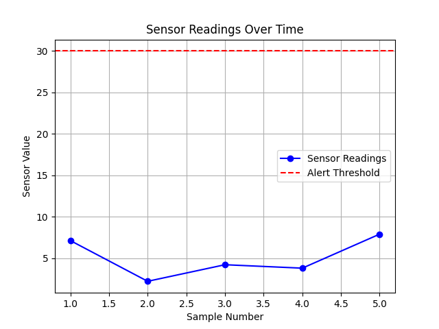
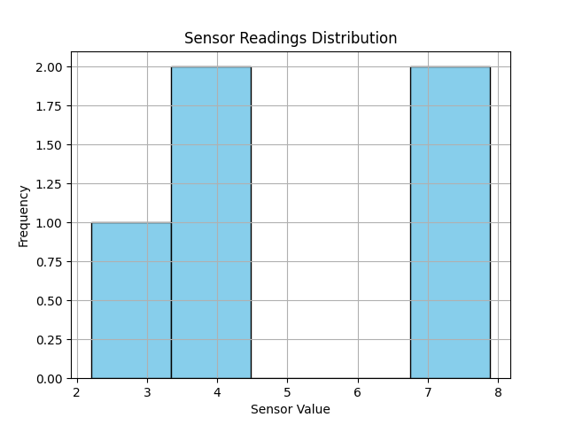

# Sensor Data Analysis Tool

## Project Description

This project is a Python program that simulates sensor readings, analyzes the data, and displays graphs.

The program does not require a physical sensor. It uses Python's `random` module to generate simulated sensor values.

## Features

- Generate random sensor readings.
- Choose the sensor type, number of readings, minimum value, maximum value, and alert threshold.
- Calculate statistics using NumPy.
- Display the number of readings, mean, minimum, maximum, and standard deviation.
- Identify readings above the alert threshold.
- Display a line graph with an alert threshold.
- Display a histogram.
- Save readings to a CSV file.
- Load existing readings from a CSV file.
- Save both graphs as PNG images.
- Handle invalid inputs and file errors.

## Requirements

- Python 3
- NumPy
- Matplotlib

## Installation

Open a terminal in the project folder and install the required libraries:

```bash
pip install -r requirements.txt
```

## How to Run

Run the program using:

```bash
python sensor_monitor.py
```

The program displays two options:

### Option 1: Generate New Sensor Readings

Enter the sensor type, number of readings, minimum value, maximum value, and alert threshold.

The program generates readings, saves them to `sensor_readings.csv`, calculates statistics, and displays two graphs.

### Option 2: Load Readings from CSV

Enter the CSV filename or press Enter to use `sensor_readings.csv`.

The program loads the existing readings, asks for an alert threshold, calculates statistics, and displays the graphs without generating new data.

## Graphs

The program creates two graphs using Matplotlib:

1. **Line graph:** Shows sensor readings by sample number and includes a horizontal alert threshold line.
2. **Histogram:** Shows the distribution of sensor readings.

Both graphs are displayed on the screen and saved automatically as PNG files.

### Line Graph



### Histogram



## Libraries Used

- **random:** Generates simulated sensor readings.
- **csv:** Saves and loads sensor readings.
- **NumPy:** Calculates statistics.
- **Matplotlib:** Creates and saves graphs.

## Project Files

- `sensor_monitor.py`: Main Python program.
- `requirements.txt`: Required Python libraries.
- `README.md`: Project documentation.
- `sensor_readings.csv`: Saved sensor readings.
- `sensor_line_graph.png`: Saved line graph.
- `sensor_histogram.png`: Saved histogram.

## Reproducibility

The program uses `random.seed(42)` so the same inputs produce the same random readings.

## Author

Student project for the Sensor Data Analysis Tool assignment.
## Example Results

The program was tested with five sensor readings.

Example statistics:
- Number of readings: 5
- Mean: 5.04
- Minimum: 2.20
- Maximum: 7.89
- Standard deviation: 2.13

The program successfully saved both graphs as PNG images.
